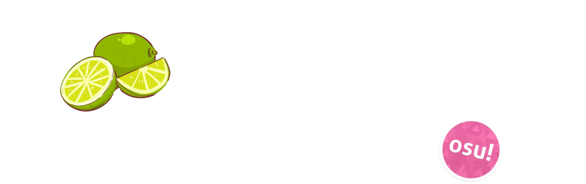

# Brand identity

How somtum.fun looks and how to write about it: our logo, its history, and who made it. Use these when you make fan art, videos, streams, tournament graphics or anything else about somtum.fun.

## Logo {id=logo}

")

The somtum.fun logo is a lime and a lime slice behind the words **somtum.fun!**, in soft lime greens. It was drawn by **@aeonvi** (on Discord). Thank you!

- Use it as it is: don't stretch, recolour, crop or add to it.
- Leave some space around it, and put it on a background it stands out from.
- Don't put it together with osu!'s logo or ppy's branding, or use it in a way that suggests somtum.fun is part of osu!.

### Colours {id=colours}

| Colour | Hex |
| :-- | :-- |
| Lime | `#CDE7A5` |
| Pale lime | `#E2F0DA` |
| Soft green | `#B2CF9B` |
| Leaf green | `#6F995F` |
| Grey green (outline) | `#8FA58A` |

## Logo history {id=history}

| Logo | Years | Made by |
| :-- | :-- | :-- |
|  | Development builds from 2025; somtum.fun from 2026 to now | **@aeonvi** (on Discord) |
|  | 2024 to 2025, from the beginning of somtum | **[blueskychan_](/users/2)**, made with the PixelLab app on Android |

The first logo was made by blueskychan_ when somtum started, and was used until 2025. The current logo, by @aeonvi, was first used for our development builds in 2025, and has been somtum.fun's logo since 2026.

## Names {id=names}

Call us what you like: **somtum.fun**, **Somtum.fun!**, **Somtum** or **somtum** are all fine. The one thing we don't use is a name that starts with **osu!**, such as *osu!somtum* or *osu!tumthai*: osu! is ppy's name, and we aren't part of osu!.

| Our things | Not |
| :-- | :-- |
| **somtum.fun**, **Somtum.fun!**, **Somtum** | osu!somtum |
| **TumThai** (our version of osu!lazer) | osu!tumthai |
| **Somtum Launcher**, **Somtum Patcher** | osu!somtum launcher, osu!somtum patcher |

When you need to say what somtum.fun is: *somtum.fun is a fan-run private server for the osu! game. It is not affiliated with ppy Pty Ltd. osu! is a trademark of ppy Pty Ltd.*

## Getting the logo {id=download}

Right-click the logo at the top of this page and save it, or download it from the [somtum-wiki repository](https://github.com/somtum-fun/somtum-wiki/tree/main/wiki/Brand_identity/img). For anything else (a bigger size, another format, or using it on something you sell), ask us on our [Discord](https://discord.gg/U6Ztb3mRyz).
