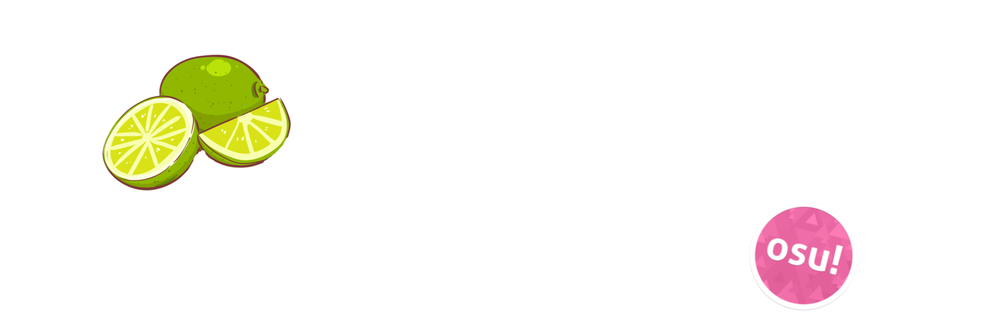

# อัตลักษณ์แบรนด์

หน้าตาของ somtum.fun และวิธีเขียนถึงเรา: โลโก้ ประวัติของโลโก้ และผู้ออกแบบ ใช้ข้อมูลนี้เมื่อทำแฟนอาร์ต วิดีโอ สตรีม กราฟิกทัวร์นาเมนต์ หรืออะไรก็ตามเกี่ยวกับ somtum.fun

## โลโก้ {id=logo}

")

โลโก้ somtum.fun คือมะนาวและมะนาวฝานอยู่หลังคำว่า **somtum.fun!** ในโทนเขียวมะนาวอ่อน ๆ วาดโดย **@aeonvi** (บน Discord) ขอบคุณมาก!

- ใช้ตามต้นฉบับ: อย่ายืด เปลี่ยนสี ครอป หรือเติมอะไรลงไป
- เว้นที่ว่างรอบโลโก้ และวางบนพื้นหลังที่ทำให้โลโก้เด่น
- อย่าวางคู่กับโลโก้ของ osu! หรือแบรนด์ของ ppy หรือใช้ในแบบที่ทำให้เข้าใจว่า somtum.fun เป็นส่วนหนึ่งของ osu!

### สี {id=colours}

| สี | Hex |
| :-- | :-- |
| มะนาว | `#CDE7A5` |
| มะนาวอ่อน | `#E2F0DA` |
| เขียวนุ่ม | `#B2CF9B` |
| เขียวใบไม้ | `#6F995F` |
| เขียวเทา (เส้นขอบ) | `#8FA58A` |

## ประวัติโลโก้ {id=history}

| โลโก้ | ปี | ผู้ออกแบบ |
| :-- | :-- | :-- |
|  | เวอร์ชันพัฒนาตั้งแต่ 2025; somtum.fun ตั้งแต่ 2026 ถึงปัจจุบัน | **@aeonvi** (บน Discord) |
|  | 2024 ถึง 2025 ตั้งแต่เริ่ม somtum | **[blueskychan_](/users/2)** ทำด้วยแอป PixelLab บน Android |

โลโก้แรกทำโดย blueskychan_ ตอนที่ somtum เริ่มต้น และใช้จนถึงปี 2025 โลโก้ปัจจุบันโดย @aeonvi ใช้ครั้งแรกกับเวอร์ชันพัฒนาของเราในปี 2025 และเป็นโลโก้ของ somtum.fun ตั้งแต่ปี 2026

## ชื่อ {id=names}

เรียกเราแบบไหนก็ได้: **somtum.fun**, **Somtum.fun!**, **Somtum** หรือ **somtum** ใช้ได้หมด สิ่งเดียวที่เราไม่ใช้คือชื่อที่ขึ้นต้นด้วย **osu!** เช่น *osu!somtum* หรือ *osu!tumthai* เพราะ osu! เป็นชื่อของ ppy และเราไม่ได้เป็นส่วนหนึ่งของ osu!

| ของเรา | ไม่ใช่ |
| :-- | :-- |
| **somtum.fun**, **Somtum.fun!**, **Somtum** | osu!somtum |
| **TumThai** (osu!lazer เวอร์ชันของเรา) | osu!tumthai |
| **Somtum Launcher**, **Somtum Patcher** | osu!somtum launcher, osu!somtum patcher |

เมื่อต้องอธิบายว่า somtum.fun คืออะไร: *somtum.fun เป็นเซิร์ฟเวอร์ส่วนตัวของเกม osu! ที่แฟน ๆ ดูแลกันเอง ไม่มีส่วนเกี่ยวข้องกับ ppy Pty Ltd osu! เป็นเครื่องหมายการค้าของ ppy Pty Ltd*

## ดาวน์โหลดโลโก้ {id=download}

คลิกขวาที่โลโก้ด้านบนของหน้านี้แล้วบันทึก หรือดาวน์โหลดจาก[ที่เก็บ somtum-wiki](https://github.com/somtum-fun/somtum-wiki/tree/main/wiki/Brand_identity/img) สำหรับอย่างอื่น (ขนาดใหญ่กว่า รูปแบบไฟล์อื่น หรือใช้บนสินค้าที่ขาย) ถามเราได้ใน [Discord](https://discord.gg/U6Ztb3mRyz)
