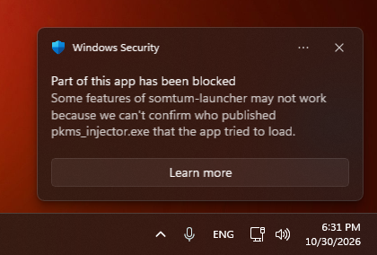

# Common problems

Quick fixes for the problems players run into most. For a message the game shows you, see [Error messages](/wiki/FAQ#errors). Still stuck, or did the game crash? [Report it](/wiki/Help_centre/Reporting_a_bug), with the logs.

## osu!(stable) and the Somtum Patcher {id=stable}

### Relax, Autopilot or the pp counter don't work {id=patcher-features}

The Somtum Patcher adds Relax and Autopilot scores, the live pp counter and its own options to osu!(stable) by changing the game while it runs. Each osu! update can move the code it changes, so on some builds a feature doesn't switch on. You might see no Relax/Autopilot scores, no pp counter, or a message that a feature has been disabled for your osu! build.

**Try the cuttingedge release stream.** In osu!, open **Options → General → Updates**, set **Release stream** to **Cutting Edge**, let osu! update, close it, and start it again from the Somtum Patcher or the Somtum Launcher. If it still doesn't work, tell us on [Discord](https://discord.gg/U6Ztb3mRyz) which osu! version you're on (it's shown under **Options → General → Updates**) and which feature is missing.

### osu! freezes, shows a black screen, or won't close after starting {id=patcher-freeze}

1. Close osu! from Task Manager (**Ctrl + Shift + Esc**, then **End task** on osu!).
2. Get the newest Somtum Patcher from the [download page](/home/download), or let the Somtum Launcher update itself.
3. Start osu! again from the Patcher.
4. Still freezing? Try the [cuttingedge release stream](#patcher-features), and tell us on [Discord](https://discord.gg/U6Ztb3mRyz).

### My antivirus or Windows blocks a download, or removed a file {id=antivirus}

Our downloads aren't **code-signed**. Signing them would cost us upwards of 300€ a year, which is too much for a free community server. Without a signature, Windows and antiviruses don't know us, so they may warn about, block or quarantine the **Somtum Launcher**, the **Somtum Patcher**, our anti-cheat (`pkms.dll`), **TumThai's** installer or our **old clients**. Some antiviruses (Windows Defender among them) also flag tools that change a running game, such as the Patcher and the anti-cheat, by mistake.

**"Windows protected your PC"** (SmartScreen) when you open a download: click **More info**, then **Run anyway**.

**"Part of this app has been blocked"** (Smart App Control): an exception won't help, see [Smart App Control](#smart-app-control).

**Your antivirus blocked or removed a file:** add an exception (a whitelist entry) for the folder, then download it again from the [download page](/home/download). In Windows Security:

1. Open **Windows Security**, then **Virus & threat protection**.
2. If it already removed the file: **Protection history**, pick the entry, then **Actions**, **Restore** (or **Allow on device**).
3. Under **Virus & threat protection settings**, click **Manage settings**, then **Exclusions**, **Add or remove exclusions**, **Add an exclusion**, **Folder**, and pick the folder: the Somtum Launcher's, the Patcher's, TumThai's or your old client's.

Other antiviruses (Avast, AVG, Kaspersky, Norton, Bitdefender, ...) have the same thing under a name like *Exceptions*, *Exclusions* or *Allowed list*. If yours still won't let it install, you can turn its real-time protection off just while you install, then turn it back on and add the exception.

Only do this for files from our [download page](/home/download) (dl.somtum.fun): we never send downloads through Discord DMs or other sites. Without the anti-cheat your scores aren't submitted, so if `pkms.dll` was removed, restore it or download the client again.

### Windows says "Part of this app has been blocked" (Smart App Control) {id=smart-app-control}

Recent Windows security updates block apps that aren't code-signed by default, through a feature called **Smart App Control**. Ours [aren't signed](#antivirus), so this affects **every somtum build**: TumThai, the old clients, and osu!(stable) with the Somtum Patcher or the Somtum Launcher. The file named in the popup can differ.

Smart App Control has no list of allowed apps, so an [antivirus exception](#antivirus) doesn't help here, and **Run anyway** doesn't appear. To play, you need to turn it off:

1. Click the Windows search bar, type **Smart App Control**, and open the first result. Or open **Windows Security**, then **App & browser control**, then **Smart App Control settings**.
2. Change it from **On** to **Off**.
3. Start the game again.

Smart App Control protects your whole PC, not just the game, so keep your other downloads to places you trust once it's off. On an up-to-date Windows you can usually turn it back on later from the same page, but on some PCs the option stays greyed out, and getting it back may take a Windows update or a reset of the PC.

**This may not work on a work or school PC**, or any other PC you don't own: the organisation that manages it may control this setting. If you can't change it there, ask whoever looks after that PC, or play on your own.

### ReShade or another shader tool {id=reshade}

They aren't allowed: they put their own `opengl32.dll`, `d3d9.dll` or `dxgi.dll` next to `osu!.exe`, the way some cheats load. Delete that file from your osu! folder (see [Playing with the Somtum Patcher](/wiki/FAQ#somtum-patcher)).

### Linux (Wine): osu! closes while starting {id=wine}

A first start under Wine can be slow. If you see "osu! did not finish starting within 10 seconds", just start it again: the second start is usually quick. See [the error message](/wiki/FAQ#error-patcher-start).

## TumThai {id=tumthai}

### My osu!lazer beatmaps, skins and replays aren't there {id=tumthai-import}

TumThai keeps its own files, apart from osu!lazer's. See [bringing your osu!lazer beatmaps and replays](/wiki/FAQ#tumthai-import).

### A custom ruleset doesn't show up or won't start {id=custom-rulesets}

Custom rulesets are installed in TumThai's **Settings → General → Custom rulesets**, and are ready at once. If one says it can't load, press **Update** there (the server may have moved to a newer release of it), or **Remove** it and install it again. Only the rulesets listed there are ranked here.

### TumThai!Next {id=tumthai-next}

TumThai!Next is TumThai's faster, experimental stream. If it misbehaves (a black screen, "No usable renderer was found", stutters at very high frame rates), switch back to TumThai (on the Somtum Launcher's TumThai page, or **Settings → General → Updates → Release stream** if you installed it yourself), or pick another renderer in **Settings → Graphics**, and [tell us](/wiki/Help_centre/Reporting_a_bug) what happened.

### "Score will not be submitted" {id=tumthai-not-submitted}

Usually your TumThai is out of date: an installed TumThai updates itself, or download it again from the [download page](/home/download). The message says why underneath; see [Why didn't my score submit?](/wiki/FAQ#score-not-submitted).

## Old clients (2008 to 2015) {id=legacy}

### The old client won't start {id=legacy-start}

Old builds need **.NET Framework 3.5** (a few 2015 builds need .NET Framework 4). On Windows 10 and 11, turn it on in **Control Panel → Programs → Turn Windows features on or off → .NET Framework 3.5**. Keep `pkms.dll` next to `osu!.exe`, or your scores aren't submitted.

## Accounts {id=accounts}

### "This is a new device" when logging in {id=new-device}

Confirm the device on [the verification page](/p/verify) (sign in to this website first), then log in again. See [the error message](/wiki/FAQ#error-new-device).
