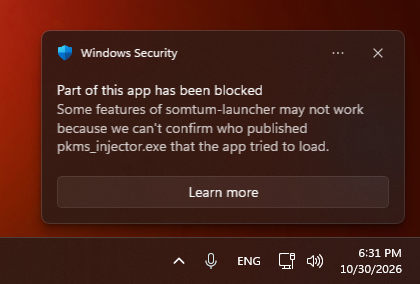

# ปัญหาที่พบบ่อย

วิธีแก้ปัญหาที่ผู้เล่นเจอบ่อยที่สุด ถ้าเกมแสดงข้อความแจ้งเตือน ดู[ข้อความแจ้งข้อผิดพลาด](/wiki/FAQ#errors) ยังแก้ไม่ได้ หรือเกมแครช? [รายงานให้เรารู้](/wiki/Help_centre/Reporting_a_bug) พร้อมไฟล์ log

## osu!(stable) และ Somtum Patcher {id=stable}

### Relax, Autopilot หรือตัวนับ pp ใช้ไม่ได้ {id=patcher-features}

Somtum Patcher เพิ่มคะแนน Relax และ Autopilot ตัวนับ pp แบบเรียลไทม์ และตัวเลือกของมันเองให้ osu!(stable) โดยแก้เกมขณะที่เกมทำงานอยู่ แต่ละครั้งที่ osu! อัปเดต โค้ดที่มันแก้อาจย้ายที่ไป ทำให้บางเวอร์ชันมีฟีเจอร์ที่เปิดไม่ติด คุณอาจไม่เห็นคะแนน Relax/Autopilot ไม่เห็นตัวนับ pp หรือเห็นข้อความว่าฟีเจอร์ถูกปิดสำหรับ osu! เวอร์ชันของคุณ

**ลองใช้ release stream แบบ cuttingedge** ใน osu! เปิด **Options → General → Updates** ตั้ง **Release stream** เป็น **Cutting Edge** ปล่อยให้ osu! อัปเดต ปิดเกม แล้วเปิดใหม่ผ่าน Somtum Patcher หรือ Somtum Launcher ถ้ายังไม่ได้ บอกเราใน [Discord](https://discord.gg/U6Ztb3mRyz) ว่าคุณใช้ osu! เวอร์ชันไหน (ดูได้ที่ **Options → General → Updates**) และฟีเจอร์ไหนที่หายไป

### osu! ค้าง จอดำ หรือปิดไม่ได้หลังเปิดเกม {id=patcher-freeze}

1. ปิด osu! จาก Task Manager (**Ctrl + Shift + Esc** แล้วกด **End task** ที่ osu!)
2. ดาวน์โหลด Somtum Patcher เวอร์ชันล่าสุดจาก[หน้าดาวน์โหลด](/home/download) หรือปล่อยให้ Somtum Launcher อัปเดตตัวเอง
3. เปิด osu! ใหม่ผ่าน Patcher
4. ยังค้างอยู่? ลองใช้ [release stream แบบ cuttingedge](#patcher-features) แล้วบอกเราใน [Discord](https://discord.gg/U6Ztb3mRyz)

### แอนตี้ไวรัสหรือ Windows บล็อกการดาวน์โหลด หรือลบไฟล์ไป {id=antivirus}

ไฟล์ของเรา**ไม่ได้เซ็นโค้ด (code-signed)** การเซ็นมีค่าใช้จ่ายมากกว่า 300 ยูโรต่อปี ซึ่งมากเกินไปสำหรับเซิร์ฟเวอร์ชุมชนที่เล่นฟรี เมื่อไม่มีลายเซ็น Windows และแอนตี้ไวรัสจึงไม่รู้จักเรา และอาจเตือน บล็อก หรือกักกัน **Somtum Launcher**, **Somtum Patcher**, ระบบกันโกงของเรา (`pkms.dll`), ตัวติดตั้ง **TumThai** หรือ**ไคลเอนต์รุ่นเก่า** แอนตี้ไวรัสบางตัว (รวมถึง Windows Defender) ยังเข้าใจผิดว่าเครื่องมือที่แก้เกมขณะทำงาน เช่น Patcher และระบบกันโกง เป็นอันตรายด้วย

**"Windows protected your PC"** (SmartScreen) ตอนเปิดไฟล์: คลิก **More info** แล้วคลิก **Run anyway**

**"Part of this app has been blocked"** (Smart App Control): การเพิ่มข้อยกเว้นช่วยไม่ได้ ดู [Smart App Control](#smart-app-control)

**แอนตี้ไวรัสบล็อกหรือลบไฟล์:** เพิ่มข้อยกเว้น (whitelist) ให้โฟลเดอร์นั้น แล้วดาวน์โหลดใหม่จาก[หน้าดาวน์โหลด](/home/download) ใน Windows Security:

1. เปิด **Windows Security** แล้วเลือก **Virus & threat protection**
2. ถ้าไฟล์ถูกลบไปแล้ว: เข้า **Protection history** เลือกรายการนั้น แล้วกด **Actions** → **Restore** (หรือ **Allow on device**)
3. ใต้ **Virus & threat protection settings** คลิก **Manage settings** → **Exclusions** → **Add or remove exclusions** → **Add an exclusion** → **Folder** แล้วเลือกโฟลเดอร์: ของ Somtum Launcher, Patcher, TumThai หรือไคลเอนต์รุ่นเก่าของคุณ

แอนตี้ไวรัสตัวอื่น (Avast, AVG, Kaspersky, Norton, Bitdefender ฯลฯ) ก็มีเมนูแบบเดียวกัน ชื่อประมาณ *Exceptions*, *Exclusions* หรือ *Allowed list* ถ้ายังติดตั้งไม่ได้ ให้ปิดการป้องกันแบบเรียลไทม์ชั่วคราวเฉพาะตอนติดตั้ง แล้วเปิดกลับและเพิ่มข้อยกเว้น

ทำแบบนี้เฉพาะกับไฟล์จาก[หน้าดาวน์โหลด](/home/download) ของเรา (dl.somtum.fun) เท่านั้น เราไม่เคยส่งไฟล์ผ่าน DM ใน Discord หรือเว็บอื่น ถ้าไม่มีระบบกันโกง คะแนนจะไม่ถูกส่ง ดังนั้นถ้า `pkms.dll` ถูกลบ ให้กู้คืนหรือดาวน์โหลดไคลเอนต์ใหม่

### Windows ขึ้นว่า "Part of this app has been blocked" (Smart App Control) {id=smart-app-control}

อัปเดตความปลอดภัยล่าสุดของ Windows บล็อกแอปที่ไม่ได้เซ็นโค้ดโดยค่าเริ่มต้น ผ่านฟีเจอร์ชื่อ **Smart App Control** ไฟล์ของเรา[ไม่ได้เซ็น](#antivirus) จึงมีผลกับ**ทุกโปรแกรมของ somtum**: TumThai, ไคลเอนต์รุ่นเก่า และ osu!(stable) ที่เปิดผ่าน Somtum Patcher หรือ Somtum Launcher ชื่อไฟล์ในหน้าต่างอาจต่างไปจากรูป

Smart App Control ไม่มีรายการแอปที่อนุญาต [ข้อยกเว้นในแอนตี้ไวรัส](#antivirus) จึงช่วยไม่ได้ และจะไม่มีปุ่ม **Run anyway** ถ้าจะเล่น ต้องปิดมัน:

1. คลิกช่องค้นหาของ Windows พิมพ์ **Smart App Control** แล้วเปิดผลลัพธ์แรก หรือเปิด **Windows Security** → **App & browser control** → **Smart App Control settings**
2. เปลี่ยนจาก **On** เป็น **Off**
3. เปิดเกมใหม่

Smart App Control ปกป้องทั้งเครื่อง ไม่ใช่แค่เกม เมื่อปิดแล้วควรดาวน์โหลดไฟล์จากแหล่งที่เชื่อถือได้เท่านั้น บน Windows ที่อัปเดตล่าสุด ปกติจะเปิดกลับได้จากหน้าเดิม แต่บางเครื่องตัวเลือกจะเป็นสีเทา และอาจต้องรออัปเดต Windows หรือรีเซ็ตเครื่องถึงจะเปิดกลับได้

**วิธีนี้อาจใช้ไม่ได้กับคอมของที่ทำงานหรือโรงเรียน** หรือคอมที่คุณไม่ได้เป็นเจ้าของ เพราะองค์กรที่ดูแลเครื่องอาจล็อกการตั้งค่านี้ไว้ ถ้าเปลี่ยนไม่ได้ ให้ถามผู้ดูแลเครื่อง หรือเล่นบนเครื่องของคุณเอง

### ReShade หรือโปรแกรม shader อื่น ๆ {id=reshade}

ไม่อนุญาต เพราะโปรแกรมเหล่านี้วางไฟล์ `opengl32.dll`, `d3d9.dll` หรือ `dxgi.dll` ของตัวเองไว้ข้าง `osu!.exe` แบบเดียวกับที่โปรแกรมโกงบางตัวใช้ ลบไฟล์นั้นออกจากโฟลเดอร์ osu! (ดู[การเล่นกับ Somtum Patcher](/wiki/FAQ#somtum-patcher))

### Linux (Wine): osu! ปิดตัวเองตอนกำลังเปิด {id=wine}

การเปิดครั้งแรกบน Wine อาจช้า ถ้าเห็นข้อความ "osu! did not finish starting within 10 seconds" ให้เปิดใหม่อีกครั้ง ครั้งที่สองมักจะเร็ว ดู[ข้อความนี้](/wiki/FAQ#error-patcher-start)

## TumThai {id=tumthai}

### บีทแมพ สกิน และรีเพลย์จาก osu!lazer ไม่ขึ้น {id=tumthai-import}

TumThai เก็บไฟล์แยกจาก osu!lazer ดู[การนำบีทแมพและรีเพลย์จาก osu!lazer มาใช้](/wiki/FAQ#tumthai-import)

### รูลเซ็ตเสริมไม่ขึ้นหรือเปิดไม่ได้ {id=custom-rulesets}

รูลเซ็ตเสริมติดตั้งได้ที่ **Settings → General → Custom rulesets** ใน TumThai และใช้ได้ทันที ถ้าขึ้นว่าโหลดไม่ได้ ให้กด **Update** ตรงนั้น (เซิร์ฟเวอร์อาจเปลี่ยนไปใช้เวอร์ชันใหม่แล้ว) หรือกด **Remove** แล้วติดตั้งใหม่ เฉพาะรูลเซ็ตที่อยู่ในรายการนั้นเท่านั้นที่มีอันดับที่นี่

### TumThai!Next {id=tumthai-next}

TumThai!Next คือเวอร์ชันที่เร็วกว่าและยังอยู่ในช่วงทดลองของ TumThai ถ้ามีปัญหา (จอดำ ขึ้น "No usable renderer was found" หรือกระตุกที่เฟรมเรตสูงมาก) ให้สลับกลับไปใช้ TumThai (ในหน้า TumThai ของ Somtum Launcher หรือ **Settings → General → Updates → Release stream** ถ้าติดตั้งเอง) หรือเลือก renderer อื่นใน **Settings → Graphics** แล้ว[บอกเรา](/wiki/Help_centre/Reporting_a_bug)ว่าเกิดอะไรขึ้น

### "Score will not be submitted" {id=tumthai-not-submitted}

ส่วนใหญ่เป็นเพราะ TumThai ของคุณเป็นเวอร์ชันเก่า TumThai ที่ติดตั้งไว้จะอัปเดตตัวเอง หรือดาวน์โหลดใหม่จาก[หน้าดาวน์โหลด](/home/download) ข้อความจะบอกเหตุผลไว้ด้านล่าง ดู[ทำไมคะแนนไม่ถูกส่ง?](/wiki/FAQ#score-not-submitted)

## ไคลเอนต์รุ่นเก่า (2008 ถึง 2015) {id=legacy}

### เปิดไคลเอนต์รุ่นเก่าไม่ขึ้น {id=legacy-start}

รุ่นเก่าต้องใช้ **.NET Framework 3.5** (บางรุ่นปี 2015 ใช้ .NET Framework 4) บน Windows 10 และ 11 เปิดได้ที่ **Control Panel → Programs → Turn Windows features on or off → .NET Framework 3.5** และเก็บ `pkms.dll` ไว้ข้าง `osu!.exe` ไม่เช่นนั้นคะแนนจะไม่ถูกส่ง

## บัญชี {id=accounts}

### ขึ้นว่า "This is a new device" ตอนล็อกอิน {id=new-device}

ยืนยันอุปกรณ์ที่[หน้ายืนยันตัวตน](/p/verify) (ล็อกอินเว็บไซต์นี้ก่อน) แล้วล็อกอินเกมอีกครั้ง ดู[ข้อความนี้](/wiki/FAQ#error-new-device)
