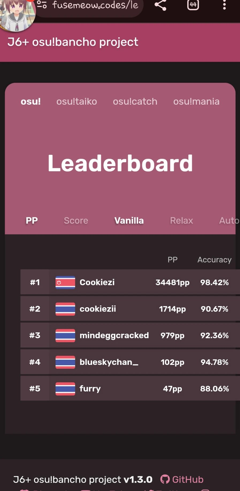
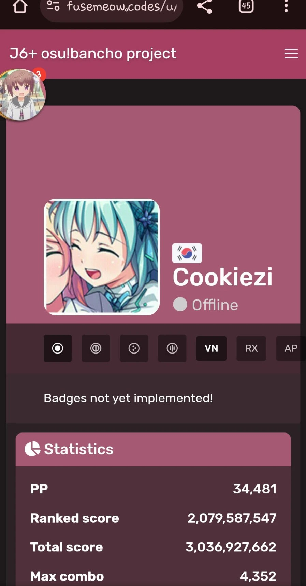
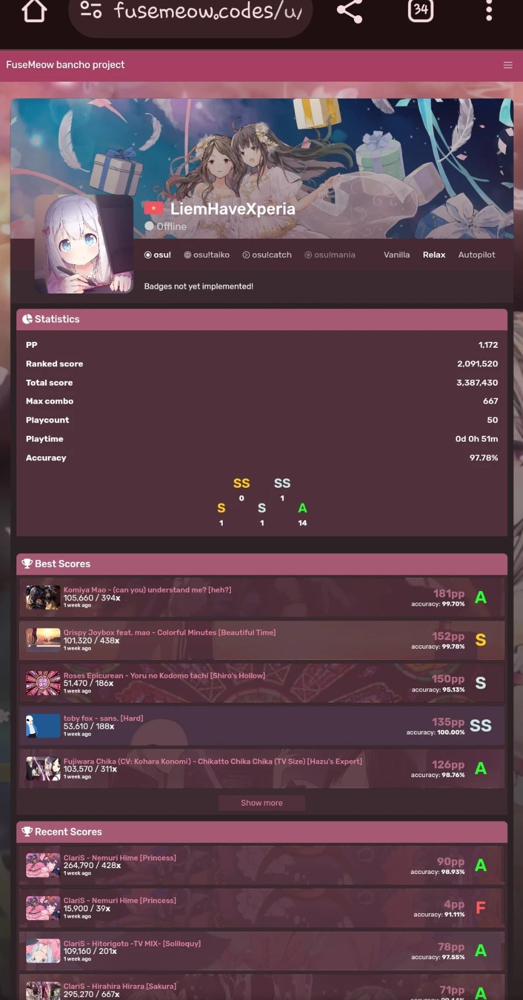
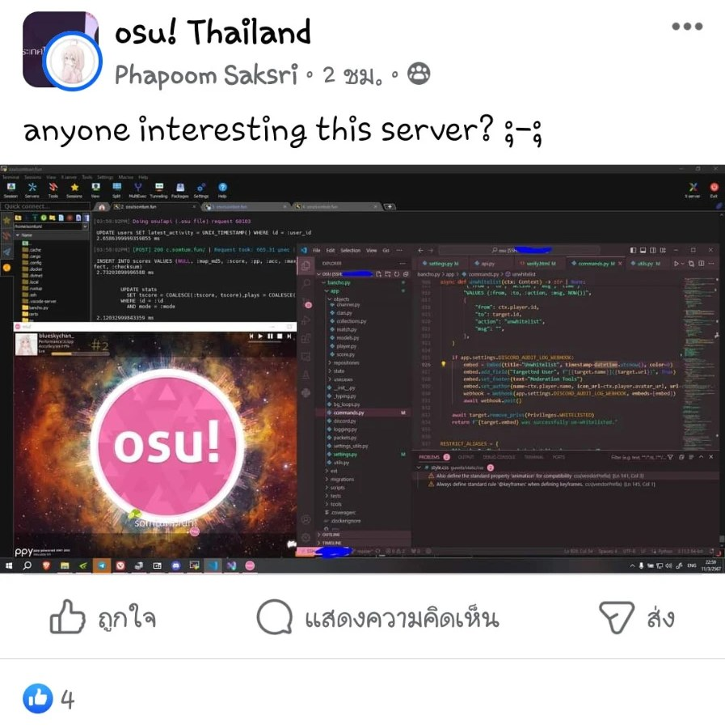

# History of somtum.fun

This page is about how somtum.fun came to be. For the game itself, see the [osu! wiki](https://osu.ppy.sh/wiki).

## Pre-somtum {id=pre-somtum}

Before somtum, our developer [blueskychan_](/users/2), then known as fusemeow, tried running an osu! server backend on her Samsung Galaxy J6+ with her friends. The project went by the names **J6+ osu!bancho project** and **FuseMeow bancho project**, and it ran at `fusemeow.codes`.

![A J6+ osu!bancho project profile page, showing the player cookiezi online and playing VINXIS - Sidetracked Day [Infinity Inside], with 844 pp](img/j6-plus-cookiezi-profile.jpg "A player's profile on the J6+ osu!bancho project")

blueskychan_ later talked about private servers with miinr in miinr's Discord server, and somehow the conversation ended up with the name "somtum".

blueskychan_ also asked about a private server in the osu! Thailand Facebook group, and a few people said they would like to try it.

