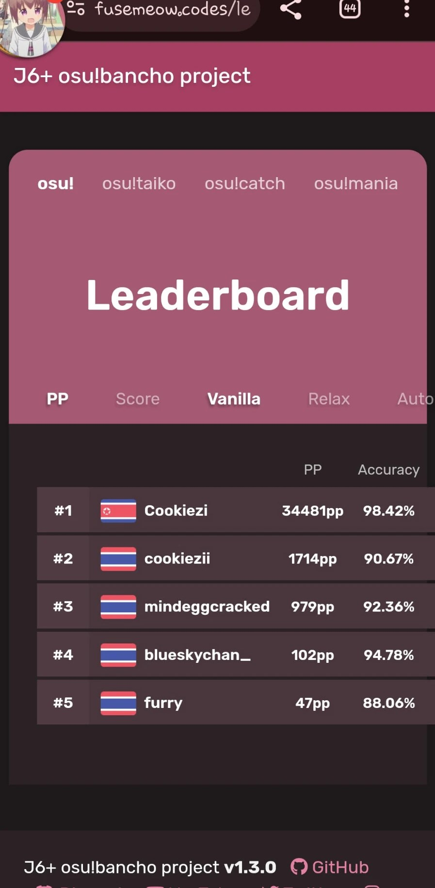
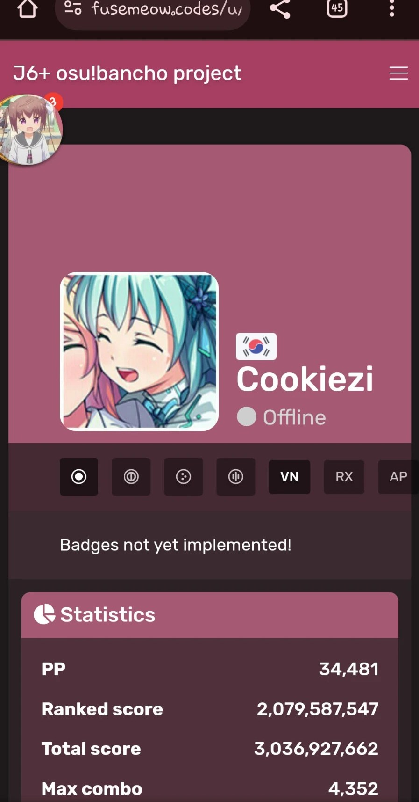
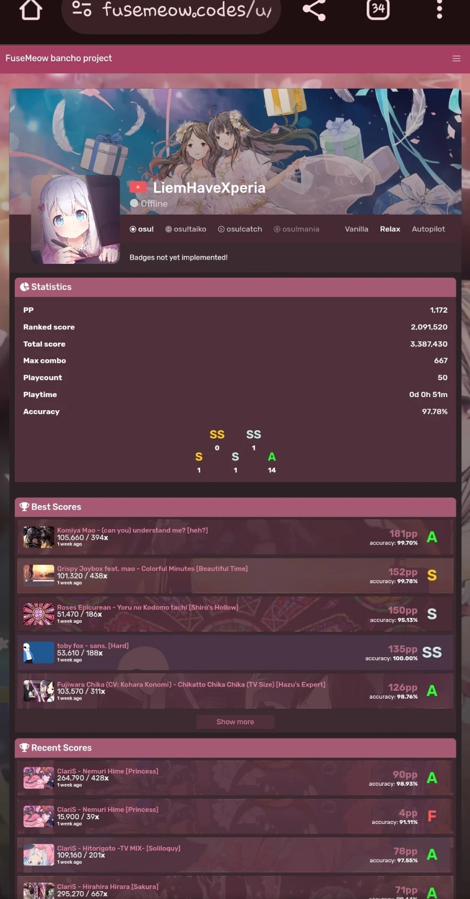
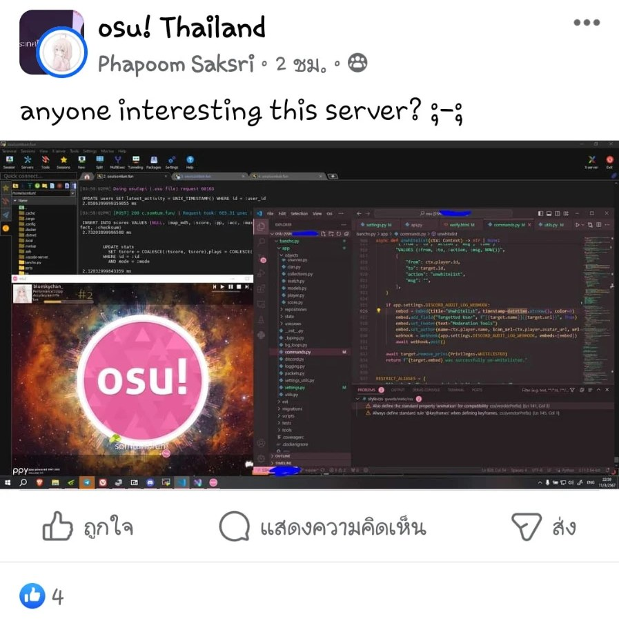

# ประวัติของ somtum.fun

หน้านี้เล่าว่า somtum.fun เกิดขึ้นมาได้อย่างไร ส่วนเรื่องของตัวเกม ดูได้ที่ [osu! wiki](https://osu.ppy.sh/wiki)

## ก่อนจะมี somtum {id=pre-somtum}

ก่อนจะมี somtum นักพัฒนาของเรา [blueskychan_](/users/2) ซึ่งตอนนั้นใช้ชื่อ fusemeow ลองรันระบบหลังบ้านของเซิร์ฟเวอร์ osu! บน Samsung Galaxy J6+ ของเธอกับเพื่อน ๆ โปรเจกต์นี้ใช้ชื่อ **J6+ osu!bancho project** และ **FuseMeow bancho project** และรันอยู่ที่ `fusemeow.codes`

![หน้าโปรไฟล์ใน J6+ osu!bancho project แสดงผู้เล่น cookiezi ออนไลน์และกำลังเล่น VINXIS - Sidetracked Day [Infinity Inside] มี 844 pp](img/j6-plus-cookiezi-profile.jpg "โปรไฟล์ผู้เล่นใน J6+ osu!bancho project")

ต่อมา blueskychan_ คุยเรื่องเซิร์ฟเวอร์ส่วนตัวกับ miinr ในเซิร์ฟเวอร์ Discord ของ miinr และบทสนทนาก็จบลงที่ชื่อ "somtum" แบบงง ๆ

blueskychan_ ยังถามเรื่องเซิร์ฟเวอร์ส่วนตัวในกลุ่ม Facebook osu! Thailand และมีหลายคนบอกว่าอยากลองเล่น

